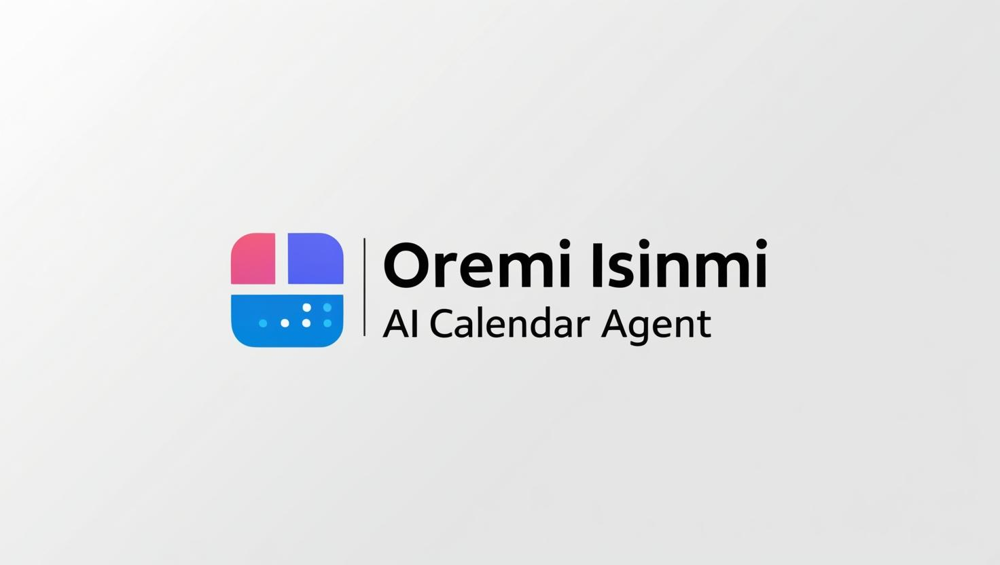

# Oremi Isinmi

**Oremi Isinmi** is the reminders, scheduling, tagging, and notification
subsystem of the Oremi personal assistant ecosystem. It provides a REST API
and MCP interface that help AI assistants and autonomous agents manage
reminders, schedules, tags, and notifications through a secure and intelligent
platform.

The name **"Oremi Isinmi"** comes from two Yorùbá words: _Oremi_,
meaning "my friend", and _Isinmi_, meaning "rest" or "appointment". Together,
the name conveys the idea of a friendly assistant that helps you manage your
time and commitments efficiently, bringing calm and order to your daily life.

## Documentation

Find the Oremi Isinmi deployment and API documentation at
[https://demsking.gitlab.io/oremi-isinmi](https://demsking.gitlab.io/oremi-isinmi).

## Development

Oremi Isinmi is built with Python and uses `uv` for dependency management. The
project follows standard Python development practices with type hints, linting,
and automated testing.

For detailed information on setting up your development environment, running
tests, code style guidelines, and the pull request process, please refer to
[CONTRIBUTING.md](https://gitlab.com/demsking/oremi-isinmi/-/blob/main/CONTRIBUTING.md).

## Versioning

Given a version number `MAJOR.MINOR.PATCH`, increment the:
This project adheres to [Semantic Versioning](https://semver.org/) (SemVer).
Version numbers follow the `MAJOR.MINOR.PATCH` format:

- **MAJOR** version increments for incompatible API changes
- **MINOR** version increments for backward-compatible new functionality
- **PATCH** version increments for backward-compatible bug fixes

## License

Copyright 2026 Sébastien Demanou. All Rights Reserved.

Licensed under the Apache License, Version 2.0. See the
[LICENSE](https://gitlab.com/demsking/oremi-isinmi/-/blob/main/LICENSE) for the
complete license text.
